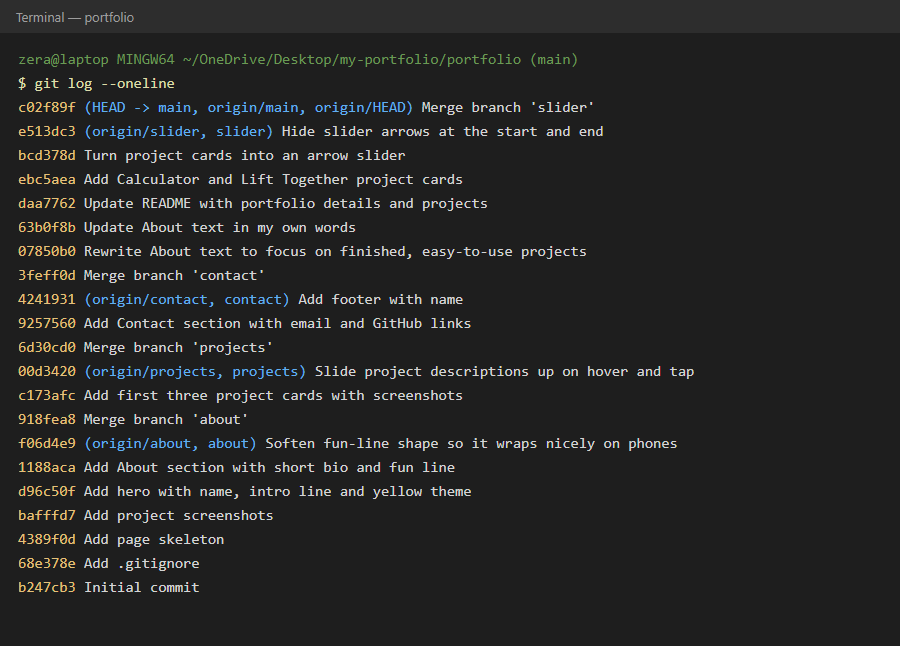

# portfolio

**Zehra Sinanović**, software engineering student from Tuzla.

My personal portfolio website: who I am, what I've built and how to reach me.

**🔗 Live site: [peperoni-hub.github.io/portfolio](https://peperoni-hub.github.io/portfolio/)**

Built with plain HTML, CSS and JavaScript, in a soft yellow theme.

## Sections

- **About**: a short intro about me
- **Projects**: an arrow slider of project cards that show a screenshot, with the description sliding up on hover or tap
- **Contact**: email and GitHub links

## Projects

- **Deskito**: a time tracker with a focus timer, calendar, notes and alarms ([GitHub](https://github.com/peperoni-hub/deskito))
- **Fernlight Hollow**: a cozy pixel-art fairy adventure game ([GitHub](https://github.com/peperoni-hub/fernlight-hollow))
- **Invoicer**: an invoice manager that tracks paid, unpaid and overdue invoices (preview only)
- **Calculator**: a simple calculator for the browser ([GitHub](https://github.com/peperoni-hub/practice-calculator))
- **Lift Together**: a workout tracker for two (preview only)

## How it was built

Each section was built on its own branch (`about`, `projects`, `contact`, `slider`) and merged into `main`.

## Commit history

